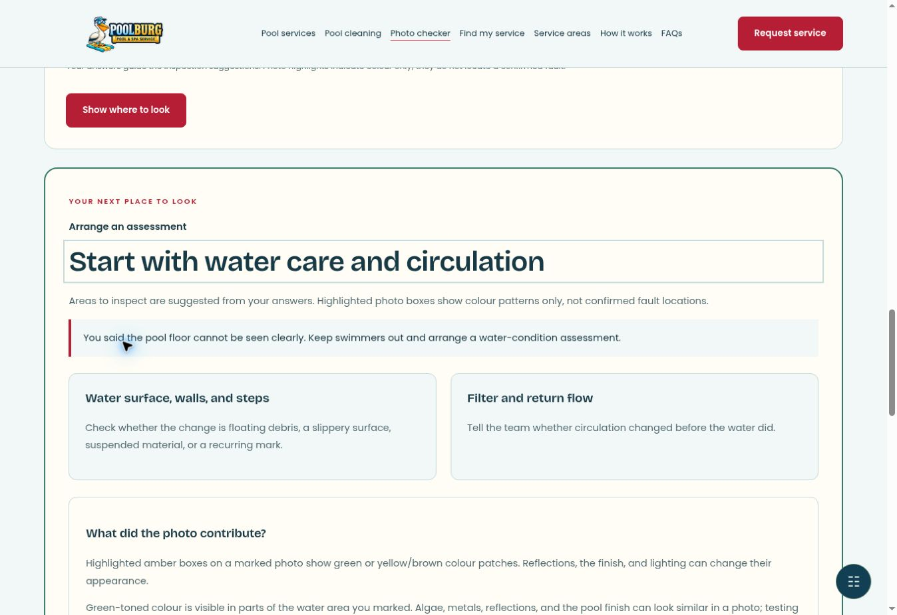

# Pools Dallas — PoolBurg

Cloned from Dboss5/holiday-lighting. The homepage is adapted for PoolBurg pool services in Dallas–Fort Worth.

## Homepage
- PoolBurg branding and images from its connected WordPress media library
- Six pool service categories linked to dedicated local service pages
- Interactive service selector and downloadable request brief
- Booking portal, call/text links, FAQs, service area section
- Display preferences and responsive navigation

## Individual services

Six dedicated service pages and `/services/` are now included. Each service page has original question-led content, contextual links to verified PoolBurg blog articles, WordPress media, a unique title and description, a self-referencing relative canonical, and Service structured data. The homepage and service selector link to these local pages.

## Production SEO

The production hostname has not been selected. At launch run `python scripts/configure_seo.py --origin https://YOUR-ACTUAL-DOMAIN` to set absolute canonical and sharing URLs and generate a sitemap for all 28 converted pool pages. Do not use the holiday-lighting hostname. The obsolete holiday sitemap was removed. `robots.txt` excludes inherited holiday routes until those pages are converted.

## Next phase
Inherited holiday service, city, blog, and visualizer pages remain unconverted and unlinked from the pool site navigation. Convert these in a later phase before enabling those routes for indexing.

## Development
Static HTML/CSS/JavaScript; no build required. Serve this directory with any static HTTP server.

See assets/pool-media-sources.json for media provenance. PoolBurg images currently use their original WordPress URLs.

## Service areas

`/service-areas/` is now a filterable directory of twelve original city guides: Dallas, Fort Worth, Frisco, Plano, Allen, McKinney, Richardson, Rockwall, Southlake, Colleyville, Flower Mound, and Coppell. Guides use distinct question-led content, city media from PoolBurg WordPress, related services, contextual blog links, nearby-city navigation, and city reference maps. No local branch addresses or response-time claims are implied. The production SEO script includes these pages.

## Pool cleaning expansion

`/pool-cleaning/` is the cleaning directory. `/weekly-service/` now covers detailed visit tasks, water testing, owner responsibilities between visits, filter/salt-system scope, records, and pricing questions. Five dedicated guides cover green-pool cleanup, one-time cleaning, filter cleaning, tile/waterline cleaning, and saltwater maintenance. All twelve city pages include individually written cleaning sections. Navigation and the production SEO script include the new routes. Content and media provenance are recorded in `assets/pool-cleaning-sources.json`.

## Pool problem checker

`/pool-checker/` is a photo-assisted inspection guide, with on-device face rejection and water-colour observations. It is not a vision-model diagnosis of pool faults: symptoms drive inspection suggestions, and user-marked water regions provide limited colour evidence. It cannot establish safe chemistry, diagnose equipment, detect cracks, or locate a hidden leak.

- Up to three still JPEG/PNG/WebP images (animated PNG/WebP are rejected before decoding), 10 MB per file, maximum 24 megapixels.
- No server upload, analytics payload, persistent photo storage, or image-containing report.
- A photo is rejected if a face is detected in any of thirteen rotated/tiled scans. A model, decode, inference, cancellation, or timeout failure never accepts an unchecked image.
- Detector: pinned face-api.js 0.22.2, TensorFlow.js CPU backend, and Tiny Face Detector. The library and model are served locally; no WebGL, third-party model download, or API key is needed.
- Detection is imperfect. Small, obscured, tilted, and side-on faces may be missed. The interface instructs users to choose images without people and does not promise perfect screening.
- Only after all scans pass is a metadata-free, resized canvas retained in tab memory. Clear/remove actions discard it; page navigation discards accepted photos too. Original filenames are not retained by the tool.
- Colour observations require the user to mark and confirm a water-only region. Lighting, reflections, pool finish, and debris can affect the result. Unclear images produce uncertainty, never clearance or a confirmed cause.
- `node --test tests/pool-checker.test.mjs` checks fail-closed admission, late face rejection, cancellation, disposal, invalid files, uncertain observations, and escalation.

Dependencies, model hash, limitations, and references: `assets/pool-checker-sources.json` and `assets/vendor/FACE-API-LICENSE.txt`. Browser QA verified rejection of a face-containing test portrait, acceptance of a pool-only PoolBurg image, confirmed-region colour highlights, symptom-based suggestions, a text-only download, and clearing photos. Unit tests use controlled detector responses and do not measure overall detection accuracy; broader browser and accuracy testing remains advisable.

Verified checker preview: 
